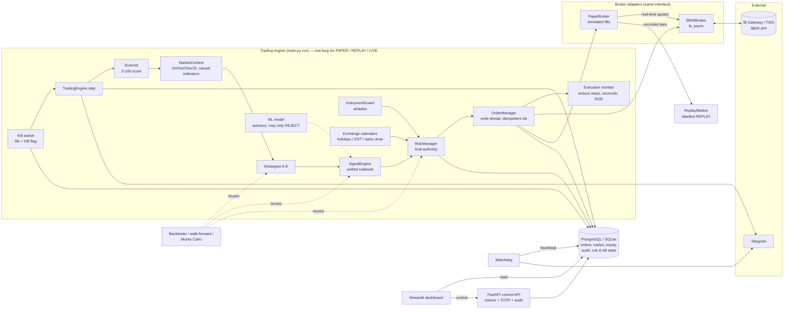

# 1. Architecture

## Component diagram



## Design principles

| Principle | How it is implemented |
|---|---|
| One code path for every mode | `TradingEngine`, `SignalEngine`, `RiskManager` and `OrderManager` are identical in paper, replay and live. Only the `Broker` adapter differs. The backtester reuses the strategies, signal engine, risk manager and cost model. |
| Risk is the final authority | Every order passes `RiskManager.evaluate` (16 checks). Limits have hard ceilings in `config.py`; ML has no handle on risk, sizing or the live gate. |
| Broker is the source of truth | Every loop reconciles internal state against broker orders, positions and executions. Unknown positions are flattened and reported. |
| Fail closed | Unknown instrument type → blocked. Stale/absent quote → no trade. Broker down → no trade. Gate evidence missing → no live trading. |
| Restart safety | Write-ahead order intents, deterministic client order ids (`orderRef`), persisted risk/kill/paper-broker state, startup reconciliation before the first new decision. |
| Protective orders at the broker | Entries are brackets with a broker-side stop and take-profit (OCA). The monitor checks every position for a live stop that covers its full size. |

## Directory layout

```
ai-stock-trader/
├── app/            domain types, trading engine, FastAPI control API
├── broker/         Broker interface, IBKR adapter (ib_async), paper broker
├── market_data/    exchange calendars, CSV/synthetic sources, replay market
├── scanner/        transparent 0-100 stock screener
├── indicators/     causal technical indicators (EMA, ATR, VWAP, RVOL, ADX, S/R …)
├── strategies/     strategy modules A-E, context builder, central signal engine
├── risk/           risk manager (sizing, limits, gate), cost model
├── execution/      order manager, position protection, reconciliation, EOD
├── portfolio/      persistence (SQLAlchemy models, state store, audit log)
├── ml/             optional advisory ML (regimes, triple-barrier signal model)
├── backtesting/    event-driven backtester, metrics, walk-forward, Monte Carlo, reports
├── dashboard/      Streamlit trading terminal
├── notifications/  Telegram notifier (informational only)
├── monitoring/     logging (JSON + secret redaction), heartbeat, health
├── security/       instrument whitelist, kill switch, auth/TOTP/HMAC, live gate
├── tests/          pytest suite (116 tests)
├── scripts/        run_tests (readiness evidence), IBKR check, backup, watchdog, healthcheck
├── deploy/         Caddyfile (TLS), systemd unit
├── data/           universe.csv (approved symbols); DB / models at runtime
├── logs/ reports/  runtime output
├── main.py config.py requirements.txt Dockerfile docker-compose.yml .env.example
```

## Deliberate technology decisions

* **Polars and Redis are not used.** Pandas covers the data volumes involved: a few dozen symbols with intraday bars.
  The database already persists all shared state (kill switch, risk halt, heartbeat), and in this system durability matters more than latency.
  Redis would add a second source of truth without a clear benefit, which conflicts with "avoid unnecessary dependencies". Both can be added if the universe grows to thousands of symbols.
* **`ib_async`** is the maintained successor of `ib_insync`. It wraps IBKR's official TWS API socket protocol.
* **`exchange_calendars`** provides holidays, early closes and DST for XNYS/XNAS/XETR.
* **SQLite** is the default for development and **PostgreSQL** is used in Docker. Both run through the same SQLAlchemy models.
